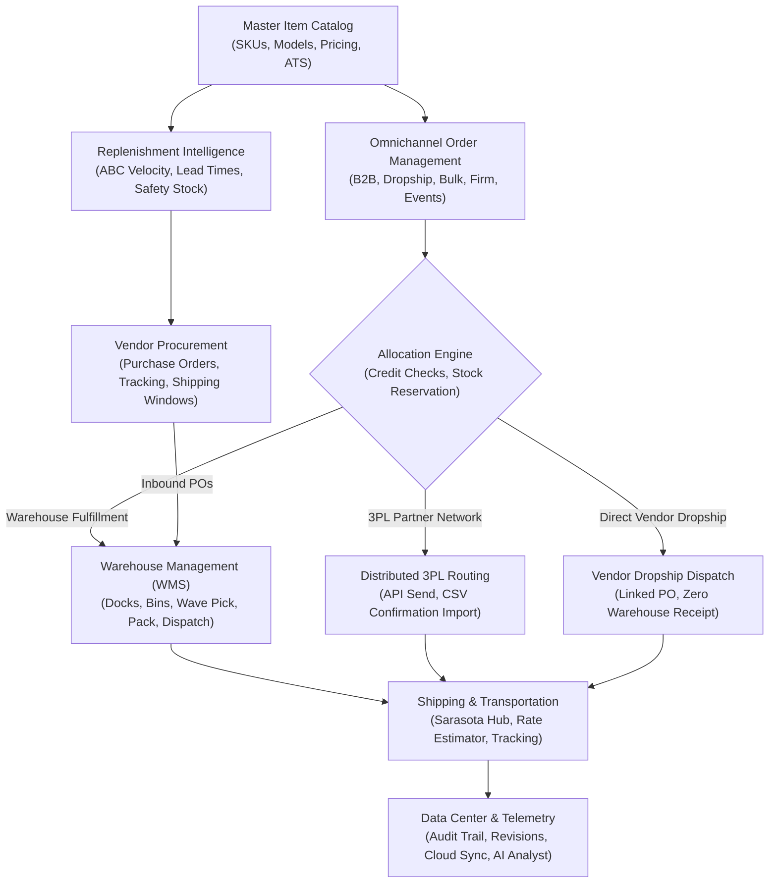
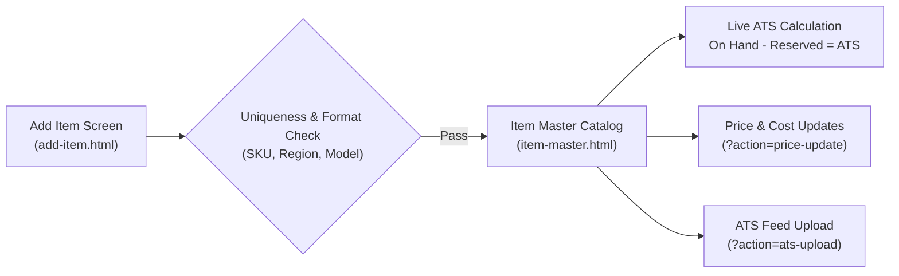
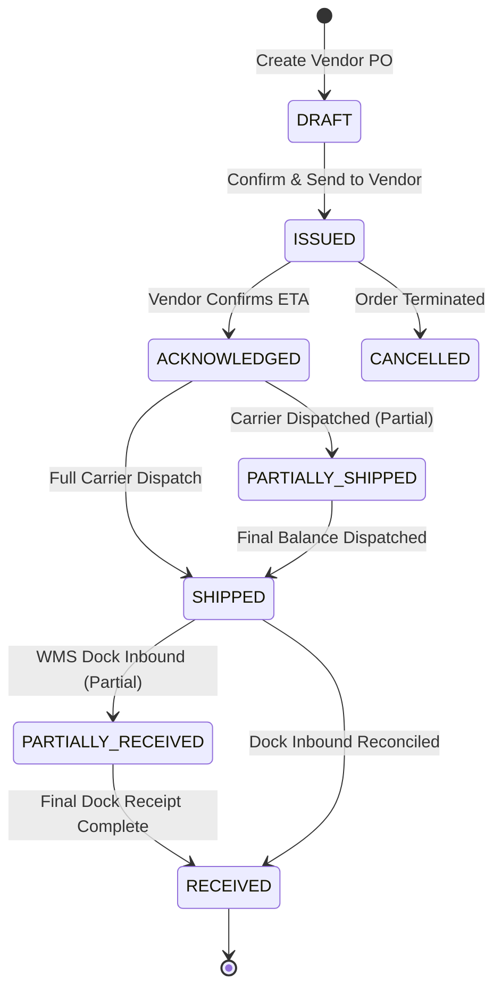
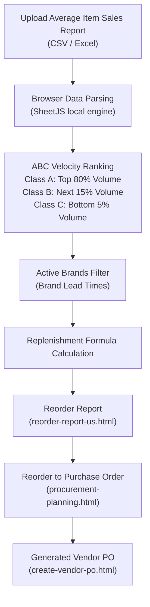

# Supply Chain Intelligence · Enterprise Operating Manual
**Version:** 2026.10 · Unified Enterprise Release  
**System Deployment:** `https://mmk97-97.github.io/SUPPLY-CHAIN-INTELLIGENCE/`  
**Classification:** Enterprise Operating Procedure & Technical Handbook  
**Target Audience:** Supply Chain Managers, Warehouse Supervisors, Procurement Specialists, Customer Order Analysts, and System Administrators.

---

## Table of Contents
1. [Executive Platform Architecture](#1-executive-platform-architecture)
2. [Global Regional Operations & Workspace Modes](#2-global-regional-operations--workspace-modes)
3. [Enterprise Control Tower (`workspace.html`)](#3-enterprise-control-tower)
4. [Master Item Catalog & ATS Feeds (`item-master.html`, `add-item.html`)](#4-master-item-catalog--ats-feeds)
5. [Omnichannel Order Management (`all-open-orders.html`, `create-order.html`)](#5-omnichannel-order-management)
6. [Vendor & Supplier Management (`vendor-management/index.html`)](#6-vendor--supplier-management)
7. [Procurement & Vendor PO Lifecycle (`procurement/index.html`, `vendor-po-management.html`)](#7-procurement--vendor-po-lifecycle)
8. [Warehouse Management System (WMS) (`warehouse-management/index.html`)](#8-warehouse-management-system-wms)
9. [Distributed 3PL Network & Integrations (`3pl-management/index.html`)](#9-distributed-3pl-network--integrations)
10. [Shipping, Freight & Transportation (`shipping/index.html`, `transportation/index.html`)](#10-shipping-freight--transportation)
11. [Regional Inventory & Replenishment Intelligence (`inventory-dashboard-us.html`)](#11-regional-inventory--replenishment-intelligence)
12. [Executive Analytics, Audit & Data Center (`business-operations.html`, `data-center.html`)](#12-executive-analytics-audit--data-center)
13. [MK Brain AI Analyst (`mk-brain.html`)](#13-mk-brain-ai-analyst)
14. [Standard Operating Procedures (SOPs)](#14-standard-operating-procedures-sops)
15. [Data Dictionary & State Machine Specifications](#15-data-dictionary--state-machine-specifications)
16. [Backup, Cloud Synchronization & Disaster Recovery](#16-backup-cloud-synchronization--disaster-recovery)

---

## 1. Executive Platform Architecture

Supply Chain Intelligence (SCI) is a high-availability, unified enterprise execution platform designed for multi-region inventory forecasting, omnichannel order routing, vendor procurement, warehouse management (WMS), and distributed 3PL logistics.

### Core Architecture Principles:
- **Single Source of Truth:** A unified shared model connects SKUs, orders, allocations, vendor POs, warehouse bins, and 3PL routing across all modules.
- **Atomic Operations & Invariant Enforcement:** Actions that touch inventory balances (such as reservations, receiving, picking, packing, bin transfers, or dispatch) execute with strict guardrails to prevent overselling, negative balances, or duplicate fulfillment.
- **Offline-First Resilience:** The system runs client-side in the browser using scoped LocalStorage, SessionStorage, and IndexedDB, allowing warehouse and dock personnel to continue operational workflows without downtime.
- **Zero-Flicker View Transitions:** Built with synchronized `@view-transition` document cross-fades and active session tracking, eliminating full-screen loading flashes during in-app navigation.

---

## 2. Global Regional Operations & Workspace Modes

### 2.1 Regional Operations (US, EU, CA)
The platform manages inventory across three dedicated operational regions:
- **US (United States - Primary):** Base currency in USD ($). Features Sarasota central fulfillment hub, US 3PL routing, domestic freight consolidation, and UPS/FedEx tracking.
- **EU (European Union):** Base currency in EUR (€). Features cross-border ATS (Available-to-Sell) feeds, EU VAT compliance, and multi-currency wholesale pricing.
- **CA (Canada):** Base currency in CAD ($). Features bilingual SKU compliance, Canadian regional distribution centers, and cross-border customs declarations.

Switching regions via the global top-bar region selector updates all regional catalog models, tax rules, currency symbols, and inventory dashboards instantaneously without losing active orders.

### 2.2 Workspace Modes: Working vs. Demo
- **Working Mode (`workspaceMode=working`):** The default operational production environment. Saves persistent transactions, custom catalog additions, purchase orders, pick waves, and sync revisions.
- **Portfolio Demo Mode (`demo=1`):** A sandboxed demonstration environment. All LocalStorage and IndexedDB keys are scoped under dynamic generational prefixes (e.g., `sci.demo.v49.g1.*`). Testing simulated orders or receiving does not overwrite production data. Click **Reset Demo Data** in the Data Center to wipe and re-seed the demo environment at any time.

---

## 3. Enterprise Control Tower (`workspace.html`)

The Enterprise Control Tower serves as the executive cockpit for supply chain directors and operational leads.

### Key Capabilities:
- **Workspace View Switch:**
  - **▦ Operational Modules:** Interactive command cards for every operational department (Item Master, Orders, Vendors, Procurement, Shipping, WMS, 3PL, Transportation, Analytics, Data Center). Each card includes direct launch links, real-time status pills, and primary action shortcuts (e.g., `+ Add item`, `+ Create customer order`, `+ Create vendor PO`).
  - **📊 Telemetry & KPIs:** Real-time metrics dashboard featuring:
    1. **Total Orders:** Live count of historical and active customer commitments.
    2. **On-Time Delivery Rate (%):** Percentage of orders delivered within target SLA.
    3. **Available Inventory:** Sum of unreserved physical inventory across active warehouses.
    4. **Digital Keys Allocated:** Security tokens and digital licenses dispatched.
    5. **Open Purchase Orders:** In-flight vendor commitments currently pending shipment or dock arrival.
    6. **Credit Exposure:** Cumulative customer receivables across regional currencies.
- **Demand & Shipments Trend Chart:** Dynamic SVG multi-line trend showing 30-day, 90-day, or all-time order volumes versus actual warehouse dispatches.
- **Regional Network Topology:** Visual status of Sarasota central dock, regional 3PL nodes, and transit links.
- **Recent System Activity:** Live audit stream displaying the latest chronological system actions (order entries, bin moves, PO updates, user logins) with human-readable timestamps.

---

## 4. Master Item Catalog & ATS Feeds (`item-master.html`, `add-item.html`)

The Item Master provides a centralized, multi-region catalog of all commercial SKUs, models, physical dimensions, costs, and wholesale prices.

### Operational Workflows:
1. **Catalog Exploration (`item-master.html`):**
   - Search across SKU, model name, brand, title, or category.
   - Filter by status: `Live`, `Fashion`, `Backorder`, `Internal Use`, `Feeds Only`.
   - Real-time stock status pills: `In Stock`, `Low Stock` (below safety threshold), `Out of Stock`.
   - Metrics bar showing total catalog SKUs, live ATS units, and total inventory value.
2. **Adding a New Catalog Item (`add-item.html`):**
   - Enter **SKU** (e.g., `SKU-US-4091`), **Model Number**, **Brand**, and **Category**.
   - Assign operational region (`US`, `EU`, `CA`).
   - Define **Unit Cost** (supplier acquisition cost) and **Wholesale Price**.
   - Specify initial physical stock quantity and target warehouse bin location.
   - Click **Save Catalog Item** to immediately propagate the SKU to Order Entry, WMS Putaway, and Decision Intelligence.
3. **Brand ATS Upload & Price Update Actions:**
   - **ATS Upload:** Upload supplier-provided available-to-sell spreadsheets to update incoming availability without manual data entry.
   - **Price Update:** Update regional wholesale price tiers and discount matrixes in bulk.

---

## 5. Omnichannel Order Management (`all-open-orders.html`, `create-order.html`)

The Order Management module orchestrates customer demand from entry to allocation, verification, and dispatch.

### 5.1 Order Entry Workflow (`create-order.html`)
1. **Header Information:** Select CRM Customer Account, specify Customer Purchase Order number, requested delivery date, and fulfillment channel (`WAREHOUSE`, `3PL`, `DROPSHIP`).
2. **Line Item Entry:**
   - Select catalog SKU/Model. The system automatically populates the title, current ATS stock, and unit price.
   - Enter quantity. The validation engine prevents decimal quantities, negative amounts, or quantities exceeding available stock (unless backorder is authorized).
3. **Financial & Credit Verification:**
   - Evaluates the customer's available credit line against total order value.
   - Orders exceeding credit limit are automatically flagged for credit review.
4. **Submission & Stock Reservation:**
   - On saving, the required quantity is atomically added to `reservedStock` for that SKU.
   - **Crucial Rule:** `onHand` physical inventory is **not** deducted at order entry. It remains on hand until the physical package is scanned and dispatched at the warehouse dock.

### 5.2 All Open Orders Dashboard (`all-open-orders.html`)
- Displays all active orders with Customer PO, Client Account, Order Date, SKU Summary, Total Units, Order Value, and Current Status.
- **Filter Bar:** Instant filtering by order status (`All`, `Pending`, `Validated`, `Picking`, `Dispatched`), search by PO or customer name.
- **Order Action Drawer:** Click any order row to open the details drawer to view line breakdown, shipping address, fulfillment route, and print packing slips.

### 5.3 Exception Queues & Specialized Execution
- **Order Issues (`order-management/issues.html`):** Surfaces orders blocked by credit hold, address validation failures, or unexpected SKU discrepancies.
- **Unvalidated Orders (`order-management/unvalidated.html`):** Queue of customer orders awaiting operational confirmation or bulk approval.
- **Cancelled Orders (`order-management/cancelled.html`):** Preserves an audit trail of rejected or cancelled orders. Cancelling an order immediately releases all reserved stock back to the ATS pool.
- **Hold & Redemption (`order-management/hold-redemption.html`):** Manages customer orders placed on administrative hold and tokenized allocations awaiting redemption.
- **Bulk & Firm Execution (`order-management/bulk-firm.html`):** High-volume contract fulfillment with locked delivery schedules and priority allocation.
- **Regional Events (`events.html`):** Trade shows, promotional events, and showroom inventory allocations. Includes an automated TV display mode (`events-tv.html`) for warehouse and dock monitors.

---

## 6. Vendor & Supplier Management (`vendor-management/index.html`)

Maintains strategic relationships, compliance contracts, performance ratings, and digital asset custody for all tier-1 and tier-2 suppliers.

### Key Capabilities:
- **Vendor Master Directory (`vendor-management/vendors.html`):** Registry of active and pending suppliers, contact leads, payment terms (Net 30, Net 60), remit-to addresses, and product line assignments.
- **Supplier SLA & Performance Scorecard (`vendor-management/sla.html`):**
  - **OTIF (On-Time In-Full) Rate:** Percentage of PO lines delivered within the committed shipping window.
  - **Quality & Defect Ratio:** Tracks damaged or quarantined units recorded during dock receiving.
  - **Lead Time Adherence:** Compares actual dock delivery dates against contracted lead times.
- **Digital Key Vault (`vendor-management/digital-vault.html`):** Secure custody and distribution log for digital keys, software licenses, and tokenized partner references.

---

## 7. Procurement & Vendor PO Lifecycle (`procurement/index.html`, `vendor-po-management.html`)

Procurement controls the end-to-end inbound replenishment pipeline from purchase order issuance to vendor shipment tracking and warehouse delivery.

### 7.1 Vendor PO Management (`vendor-po-management.html`)
Built with strict parity to enterprise purchasing requirements:
- **Overview Metrics:** Total Vendor POs, Open Balance Units, In-Transit Value, and On-Time Shipment Percentage.
- **PO Master Table:** PO Number, Supplier, Purpose (`INVENTORY`, `EVENT`, `DROPSHIP`), Ordered Qty, Shipped Qty, Shipping Window, Carrier Tracking, Status, and Action buttons.
- **Interactive PO Details Drawer:**
  - Click any PO number to slide out the PO Details drawer.
  - Shows line items, model numbers, vendor item numbers, unit costs, and extended totals.
  - **Packing Slip Management:** Upload packing slips (PDF, PNG, JPG up to 1 MB). Download or remove attachments directly from the drawer.
  - **Quick Update PO:** Modal to edit shipping windows, update carrier tracking numbers, and record vendor shipment confirmations.

### 7.2 Creating a Vendor PO (`create-vendor-po.html`)
1. Select Vendor and Receiving Warehouse (`Sarasota Central Dock`, `Tampa Regional`, `Orlando Facility`).
2. Set Target Delivery Date (ETA) and committed **Shipping Window** (e.g., `2026-10-20 to 2026-10-28`).
3. Add Catalog Models:
   - Selecting a catalog model automatically populates its title, description, and standard unit cost.
   - Enter vendor item number and order quantity.
   - Add multiple lines as required.
4. Submit PO: Generates a unique tracking reference (e.g., `PO-1738924012`) and updates the procurement pipeline immediately.

### 7.3 Dropship PO Operations (`dropship-po.html`)
Dedicated module for customer orders fulfilled directly by the manufacturer:
- **Direct Linkage:** Links customer order numbers directly to vendor dropship purchase orders.
- **Ship-to Address Synchronization:** Customer shipping address is dynamically mapped from the customer order.
- **Zero-Warehouse Impact:** When the vendor confirms dispatch with tracking, the customer order is updated to `DISPATCHED` without increasing or deducting warehouse physical stock.

---

## 8. Warehouse Management System (WMS) (`warehouse-management/index.html`)

The WMS module governs physical dock operations, inventory slotting, picking waves, packing stations, and cycle counts.

### 8.1 Dock Receiving & Putaway (`warehouse-management/receiving.html`)
1. **Identify PO:** Enter Vendor PO number or select from the pending dock queue.
2. **Inspect & Quantify Units:**
   - Enter physical count received.
   - If damaged units are identified, enter damaged quantity:
     - **Damaged Disposition Rule:** Damaged units post to physical inventory for accounting reconciliation but are strictly quarantined from the available ATS balance.
3. **Putaway Allocation:** Designate the target warehouse bin (e.g., `A-01-02-B`).
4. **Idempotent Confirmation:**
   - Receiving automatically updates the linked Vendor PO's `shipped`/`received` balances.
   - If receiving is partial, the PO remains in `PARTIALLY_RECEIVED` until the final balance arrives.
   - Clicking receive multiple times is idempotent and will not duplicate stock.

### 8.2 Inventory & Bin Management (`warehouse-management/inventory-bins.html`)
- **Warehouse Bin Grid:** Visual map of aisles, bays, shelves, and bins across Sarasota Central.
- **Bin Stock Audit:** View SKU, model, on-hand units, reserved units, and available capacity per bin.
- **Internal Bin Transfers:**
  - Transfer units between bins (e.g., from Receiving Staging `REC-01` to High-Bay Pick Location `A-02-01-A`).
  - **Reservation Protection:** Transferring stock will strictly reject if attempting to transfer units currently allocated to an active pick wave.

### 8.3 Wave Picking (`warehouse-management/wave-picking.html`)
- Aggregates multiple open customer orders into wave batches grouped by warehouse zone.
- Generates pick lists sequenced by shortest physical walking path.
- Marks orders as `PICKING` to lock inventory against competing order modifications.

### 8.4 Packing & Dispatch (`warehouse-management/packing-dispatch.html`)
1. Operator selects or scans pick wave batch.
2. Verifies line-item model numbers and quantities into shipping cartons.
3. Assigns shipping carrier (UPS Ground, FedEx Express, Freight LTL) and enters tracking number.
4. Clicks **Dispatch Order**:
   - Atomically deducts physical `onHand` stock.
   - Releases the corresponding `reservedStock`.
   - Transitions customer order status to `DISPATCHED`.
   - Writes a permanent dispatch record into the audit log.

### 8.5 Cycle Counts (`warehouse-management/cycle-counts.html`)
- Schedules blind physical counts for specific aisles, brands, or high-velocity SKUs.
- Compares physical counted units against system book inventory.
- Calculates variance and generates an atomic reconciliation entry upon supervisor authorization.

---

## 9. Distributed 3PL Network & Integrations (`3pl-management/index.html`)

Manages outsourced logistics partners fulfilling customer orders from external facilities.

### Operational Features:
- **3PL Routing Rules (`3pl-management/routing.html`):** Automatically routes orders to regional 3PL partners based on geographic proximity, customer program, or SKU availability.
- **Shipment Requests (`3pl-management/shipment-requests.html`):** Tracks pending requests queued for electronic partner transmission.
- **Batch Confirmation Import (`3pl-management/upload-shipments.html`):**
  - Ingests CSV or Excel shipment confirmations provided by 3PL partners.
  - Required columns: `shipmentId`, `quantity`, `tracking`, `carrier`, `shippedDate`.
  - Validates full remaining quantities and skips duplicate records automatically.
- **Outbound API Contract (`3pl-management/integrations.html`):**
  - Contract specification: `stark.3pl.order.v1`.
  - Incorporates deterministic idempotency keys based on request IDs to eliminate duplicate dispatches across unreliable networks.
- **Reconciliation & SLA Scorecard (`3pl-management/reconciliation.html`):** Tracks partner fulfillment lead times, delayed shipments, and inventory discrepancy adjustments.

---

## 10. Shipping, Freight & Transportation (`shipping/index.html`, `transportation/index.html`)

Controls outgoing carrier dispatches, freight rating, and multi-carrier parcel tracking.

### Modules:
1. **Sarasota Dock Dispatch (`shipping/index.html`):** Central packing and shipping queue for all orders fulfilled internally at Sarasota.
2. **Daily Shipment Report (`shipping/daily-report.html`):** Chronological log of all daily carrier pickups, total units dispatched, gross weight, and assigned bill of lading (BOL) numbers.
3. **Freight Estimator (`freight-estimator.html`):** Live rate estimation based on freight class (Class 50 to Class 500), pallet count, total weight, origin, and destination zip code.
4. **Freight Consolidator (`freight-consolidate.html`):** Optimizes multi-order shipments into consolidated LTL/FTL truckloads to minimize freight spend.
5. **Multi-Carrier Shipment Tracking (`shipment-tracking.html`):** Unified tracking interface supporting direct tracking number lookups across FedEx, UPS, DHL, and partner freight carriers.

---

## 11. Regional Inventory & Replenishment Intelligence (`inventory-dashboard-us.html`)

Provides predictive replenishment forecasting, demand planning, and automatic purchase order generation for regional inventory managers.

### 11.1 Replenishment Formula Mechanics
Recommended Reorder Quantity is calculated using the enterprise formula:

$$\text{Reorder Qty} = \lceil \text{Monthly Demand} \times (\text{Lead Time} + \text{Coverage}) + \text{Safety Stock} + \text{Client Orders} - \text{Stock On Hand} - \text{Inbound POs} \rceil$$

- **Monthly Demand:** Average monthly units sold over the past 3-month analysis period.
- **Lead Time:** Brand-specific supplier lead time in months (configured in Active Brands).
- **Coverage:** Configured target coverage window (e.g., 2.0 months).
- **Safety Stock:** Critical carrying threshold units.
- **Client Orders:** Firm open customer order commitments.
- **Stock On Hand:** Current physical warehouse stock.
- **Inbound POs:** Eligible supplier purchase orders scheduled to arrive within the supplier window.
- **Guardrail:** If the calculated quantity is $\le 0$, recommended reorder is set to `0`. Positive quantities are rounded up to whole units.

### 11.2 ABC Velocity Classification
Items are ranked by 3-month sales volume:
- **Class A (Core Revenue):** Top 80% of cumulative unit sales. Prioritized for weekly replenishment reviews.
- **Class B (Secondary Volume):** Next 15% of cumulative sales (80%–95%).
- **Class C (Long Tail):** Final 5% of cumulative sales. Subject to minimum safety holding rules.

### 11.3 Reorder to Purchase Order (`procurement-planning.html`)
One-click conversion of positive replenishment recommendations into formal vendor purchase orders, pre-filling supplier ID, model numbers, recommended quantities, and cost estimates.

---

## 12. Executive Analytics, Audit & Data Center (`business-operations.html`, `data-center.html`)

### 12.1 Business Operations Executive Suite (`business-operations.html`)
- Comprehensive enterprise profitability, revenue trends, and gross margin analysis across product categories and customer programs.
- Channel performance comparison: Wholesale Accounts vs. Direct Dropship vs. Event Programs.

### 12.2 Data Center & Backups (`data-center.html`)
- **Single-File Full System Backup:** Export a complete, cryptographically signed JSON snapshot of the entire workspace (Item Master, Orders, Vendors, POs, WMS Bins, 3PL Shipments, Audit Trails).
- **Atomic System Restore:**
  - Ingests a previously saved JSON backup file.
  - Validates schema format, entity references, and revision hashes before applying.
  - Rejects corrupted or malformed backup files atomically to prevent database corruption.
- **Audit Activity Log (`activity.html`):** Immutable chronological record of every system event, user mutation, inventory adjustment, and sync event with millisecond timestamps.

---

## 13. MK Brain AI Analyst (`mk-brain.html`)

MK Brain is the embedded natural language intelligence assistant designed for supply chain diagnosis and anomaly detection.

### Core Capabilities:
- **Conversational ERP Interrogation:** Ask questions in plain English:
  - *"Which Class A SKUs are currently below safety stock?"*
  - *"Show all open purchase orders overdue from vendor Apex Logistics."*
  - *"What is our total credit exposure across European customer accounts?"*
- **Autonomous Anomaly Detection:** Scans inventory and open orders to identify stalled pick waves, aging backorders, or delivery delays before they impact customer SLAs.
- **Replenishment Strategy Advice:** Generates natural language summaries of reorder requirements to accompany executive procurement reviews.

---

## 14. Standard Operating Procedures (SOPs)

### SOP 1: Adding a Product to Catalog & Initial Stock Receipt
1. Navigate to **Item Master** $\rightarrow$ Click **+ Add item** (`add-item.html`).
2. Input SKU, Model#, Title, Category, Region, Unit Cost, and Wholesale Price.
3. Click **Save Catalog Item**.
4. Open **Procurement** $\rightarrow$ Click **+ Create vendor PO** (`create-vendor-po.html`).
5. Select Vendor, target warehouse, delivery window, and add the newly created SKU. Click **Create vendor PO**.
6. When goods arrive at the dock, open **Warehouse Management** $\rightarrow$ **Receiving & Putaway** (`receiving.html`).
7. Enter PO number, input verified quantity, assign bin location, and click **Confirm Receipt & Putaway**.
8. Verify on **Item Master** that the SKU displays updated on-hand units and positive ATS.

### SOP 2: Processing & Fulfilling a Customer Order
1. Open **Order Management** $\rightarrow$ Click **+ Create customer order** (`create-order.html`).
2. Select Customer Account, input Customer PO#, and select line items.
3. System verifies credit and reserves stock. Click **Submit Order**.
4. Open **Warehouse Management** $\rightarrow$ **Wave Picking** (`wave-picking.html`). Add order to active pick wave.
5. Warehouse staff physically picks items according to the generated bin sequence.
6. Open **Packing & Dispatch** (`packing-dispatch.html`). Verify items, enter carrier tracking, and click **Dispatch Order**.
7. Order status changes to `DISPATCHED`, physical inventory is deducted once, and customer is notified.

### SOP 3: Executing a Direct Dropship Order
1. In **Create Order** (`create-order.html`), set Fulfillment Channel to `DROPSHIP`. Enter line items and submit.
2. Navigate to **Procurement** $\rightarrow$ **Dropship POs** (`dropship-po.html`).
3. Locate the generated Dropship PO automatically linked to the customer order.
4. Verify ship-to address matches customer destination. Transmit PO to supplier.
5. When the supplier confirms shipment with carrier tracking, open the PO, enter tracking details, and save.
6. The customer order transitions to `DISPATCHED` without touching warehouse on-hand stock.

---

## 15. Data Dictionary & State Machine Specifications

### Customer Order Lifecycle (`state.enterprise.orders`)
| State | Description | Invariant Rules |
| :--- | :--- | :--- |
| `PENDING` | Order created, awaiting validation. | Stock is reserved; `onHand` unchanged. |
| `VALIDATED` | Approved by operations / credit passed. | Stock allocation locked. |
| `PICKING` | Assigned to warehouse wave pick. | Bin transfer blocked for allocated units. |
| `PACKED` | Cartonized at packing bench. | Awaiting final carrier label. |
| `DISPATCHED` | Handed over to carrier. | `onHand` stock deducted; reservation released. |
| `DELIVERED` | Delivery confirmed by carrier. | Final terminal state. |
| `CANCELLED` | Order terminated prior to dispatch. | Reserved stock released immediately. |

### Purchase Order Lifecycle (`state.enterprise.purchaseOrders`)
| State | Description | Invariant Rules |
| :--- | :--- | :--- |
| `DRAFT` | PO prepared by buyer. | Uncommitted to vendor. |
| `ISSUED` | Sent to supplier. | Expected delivery window active. |
| `ACKNOWLEDGED`| Confirmed by supplier with ETA. | Incorporated into replenishment inbound. |
| `PARTIALLY_SHIPPED` | Inbound carrier in-transit with partial units. | Linked tracking active. |
| `SHIPPED` | Full quantity in-transit with carrier. | Inbound dock expected. |
| `PARTIALLY_RECEIVED`| Partial quantity received at dock. | Balance remains in open inbound queue. |
| `RECEIVED` | Full receipt verified and slotted. | PO closed; physical on-hand increased. |
| `CANCELLED` | PO voided before receipt. | Inbound stock removed from replenishment. |

---

## 16. Backup, Cloud Synchronization & Disaster Recovery

### Local Backup & Disaster Recovery:
- To create a complete snapshot: Open **Data Center** (`data-center.html`) $\rightarrow$ Click **Export System Backup (JSON)**. Store the file in secure secondary storage.
- To recover from corruption or replace a workstation: Open **Data Center** $\rightarrow$ Click **Choose Backup File** $\rightarrow$ Select JSON snapshot $\rightarrow$ Review audit preview $\rightarrow$ Click **Restore Workspace**.

### Cloud Synchronization:
- Connect the shared Supabase organization workspace in Data Center using your assigned organization key.
- Transmissions use optimistic revision locking (`recordRevision`). If a concurrent remote update occurred, the engine safely pauses synchronization, warns the operator of the revision conflict, and prevents overwriting newer operational data.

---
*End of Manual · Supply Chain Intelligence Enterprise Platform*
